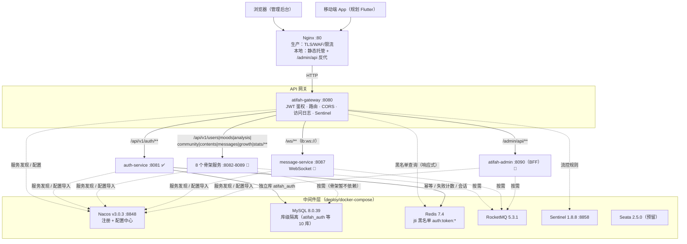
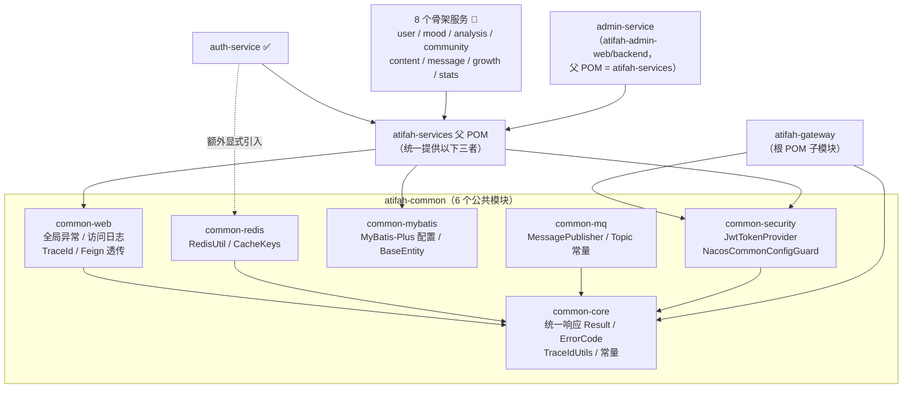

# atifah Code Wiki

> 面向开发者与 AI 助手的代码级百科。基于仓库实际代码梳理，涵盖：项目整体架构、模块职责、关键类与函数、依赖关系、运行方式。
> 配套阅读：[根 README](../README.md)（快速上手） · [architecture.md](architecture.md)（架构决策） · [db.md](db.md)（表模型）。

---

## 目录

1. [项目概览](#1-项目概览)
2. [整体架构](#2-整体架构)
3. [代码目录地图](#3-代码目录地图)
4. [Maven 模块与依赖关系](#4-maven-模块与依赖关系)
5. [atifah-common 公共组件详解](#5-atifah-common-公共组件详解)
6. [atifah-gateway API 网关详解](#6-atifah-gateway-api-网关详解)
7. [atifah-services 业务微服务详解](#7-atifah-services-业务微服务详解)
8. [atifah-admin-web 管理后台](#8-atifah-admin-web-管理后台)
9. [atifah-app 移动端](#9-atifah-app-移动端)
10. [部署与运行](#10-部署与运行)
11. [配置约定与安全基线](#11-配置约定与安全基线)
12. [测试体系](#12-测试体系)
13. [CI 与构建](#13-ci-与构建)
14. [工程规范与文档索引](#14-工程规范与文档索引)

---

## 1. 项目概览

**atifah** 是一个面向**情绪管理**场景的高并发微服务平台，业务域包括：情绪打卡与日记、趋势与量表报告、社区树洞、冥想内容、签到积分成长、消息推送、运营统计。

**当前实现状态**：

| 部分 | 状态 |
| --- | --- |
| atifah-common（6 个公共模块） | ✅ 完整实现 |
| atifah-gateway（网关） | ✅ 完整实现（鉴权链默认开启） |
| auth-service | ✅ 完整实现（注册/登录/刷新/登出） |
| 其余 8 个业务服务 | 🔨 骨架（启动类 + 配置 + Docker 化，可注册 Nacos） |
| atifah-admin-web backend（BFF） | 🔨 骨架 |
| atifah-admin-web frontend | ✅ 页面框架（Vue 3） |
| atifah-app（移动端） | 📋 规划占位（Flutter） |
| deploy（中间件/SQL/Nginx/Nacos 配置） | ✅ 就绪 |

**技术栈**：Java 21（虚拟线程）· Spring Boot 3.5.16 · Spring Cloud 2025.0.3 · Spring Cloud Alibaba 2025.0.0.0 · Nacos v3.0.3 · Spring Cloud Gateway（WebFlux 变体）· MyBatis-Plus 3.5.17（雪花 ID）· Redis 7.4 + Redisson 3.52.0 · RocketMQ 5.3.1 · Sentinel 1.8.8 · Seata 2.5.0（预留）· JJWT 0.12.7 · MySQL 8.0.39 · Vue 3.5 + Vite 8 + TS + Element Plus + Pinia · Docker Compose · GitHub Actions。

---

## 2. 整体架构

```text
  浏览器 / App ──▶ Nginx 接入层（生产：TLS/WAF/限流；本地可选：静态托管 + /admin/api 反代）
                             │
                             ▼
                    ┌─────────────────────┐
                    │  atifah-gateway :8080 │  JWT 鉴权 / 路由 / CORS / 访问日志 / Sentinel
                    └─────────┬───────────┘
        ┌─────────────────────┼──────────────────────────┐
        ▼                     ▼                          ▼
 /api/v1/** → 9 个业务服务   /ws/** → message-service   /admin/api/** → atifah-admin :8090
        │                     │                          │
        └────────── Nacos 服务发现（lb://atifah-<service>）┘

 中间件：MySQL（库级隔离 atifah_<service>）· Redis/Redisson · RocketMQ · Sentinel · Seata（预留）
```

Mermaid 版本（GitHub / 支持 Mermaid 的 Markdown 查看器可直接渲染）：



**核心链路约定**：

- API 统一经网关进入，按路径前缀路由（Nacos 负载均衡），不直连业务服务。
- 每个服务**独立数据库**（`atifah_<service>`），库级隔离、禁止跨库 JOIN。
- 公共配置统一放 Nacos 的 `common-application.yaml`（Group `ATIFAH_PUBLIC_GROUP`），服务经 `spring.config.import` 导入，`NacosCommonConfigGuard` 校验装载标记，未拉取成功**拒绝启动**。
- 管理后台静态资源由 Nginx 托管（本地 `deploy/nginx/`），不经网关。

---

## 3. 代码目录地图

```text
atifah
├── pom.xml                        # 根 POM（packaging=pom，4 个子模块）
├── atifah-common/                # 公共组件（6 子模块，见 §5）
├── atifah-gateway/               # API 网关（见 §6）
├── atifah-services/              # 业务微服务父 POM + 9 个服务（见 §7）
├── atifah-admin-web/
│   ├── backend/                  # 管理后台 BFF（artifactId=admin-service，见 §8.1）
│   └── frontend/                 # Vue 3 管理后台前端（见 §8.2）
├── atifah-app/                   # 移动端占位（规划 Flutter，见 §9）
├── deploy/
│   ├── docker-compose/           # docker-compose.yml（中间件）+ docker-compose.app.yml（11 后端容器）
│   ├── nacos/config/             # common-application.yaml / atifah-gateway.yaml / Sentinel 规则 JSON
│   ├── sql/                      # 01-init-databases.sql（10 库）+ 02-nacos-config.sql
│   ├── nginx/nginx.conf          # 管理后台前端静态托管 + 反代
│   └── dev-deploy.md             # Windows 11 本地从零部署手册
├── docs/                         # 架构/领域/DB/规则/契约/任务/评审文档（见 §14）
└── .github/workflows/ci.yml      # CI（backend / frontend / secret-scan）
```

---

## 4. Maven 模块与依赖关系

```text
atifah (root, pom)
├── atifah-common (pom)
│   ├── common-core      ←─ common-web / common-redis / common-mq / common-security
│   ├── common-web       （依赖 common-core + Spring Web/Validation/Actuator/Prometheus/Sentinel/Feign）
│   ├── common-redis     （依赖 common-core + Spring Data Redis + JSON + Redisson）
│   ├── common-mybatis   （MyBatis-Plus 自动配置 + BaseEntity）
│   ├── common-mq       （依赖 common-core + rocketmq-spring-boot-starter）
│   └── common-security （依赖 common-core + jjwt api/impl/jackson + spring-security-crypto）
├── atifah-gateway       （依赖 common-core + common-security + 响应式 Redis + SCG webflux + Nacos + Sentinel）
├── atifah-services (pom, 统一提供 common-web/common-mybatis/common-security + Nacos + OpenFeign + LoadBalancer)
│   ├── auth-service     （额外显式引入 common-redis）
│   └── user/mood/analysis/community/content/message/growth/stats-service（骨架）
└── atifah-admin-web/backend (= admin-service，继承 atifah-services 依赖约定)
```

Mermaid 版本（箭头 = Maven 依赖方向，虚线 = 显式可选引入）：



**依赖引入约定**（[atifah-services/pom.xml](../atifah-services/pom.xml#L30-L70) 注释原文）：

- **必选**：`common-web`（含 common-core）、`common-mybatis`（每服务独立库）、`common-security`（JWT 配置与 NacosCommonConfigGuard）。
- **可选**：`common-redis`、`common-mq` **不向下传递**，由实际使用 Redis/RocketMQ 的服务在自己的 `pom.xml` 显式引入——骨架服务启动不依赖中间件。当前仅 auth-service 引入 `common-redis`。
- 网关为避免阻塞 Netty 事件循环，**不引入** common-redis/Redisson，黑名单查询用响应式 `spring-boot-starter-data-redis-reactive`（[atifah-gateway/pom.xml](../atifah-gateway/pom.xml#L29-L33)）。

---

## 5. atifah-common 公共组件详解

六个模块的公共能力，业务服务按上述约定组合引入。

### 5.1 common-core — 通用结果 / 异常 / 常量

| 类 | 职责与关键 API |
| --- | --- |
| [Result.java](../atifah-common/common-core/src/main/java/com/atifah/common/core/result/Result.java) | 统一响应体 `{code, message, data, timestamp}`。静态工厂：`Result.ok()` / `Result.ok(data)` / `Result.fail(ErrorCode)` / `Result.fail(int, String)`；`isSuccess()` 判断 `code == 0` |
| [ErrorCode.java](../atifah-common/common-core/src/main/java/com/atifah/common/core/enums/ErrorCode.java) | 统一错误码枚举：`SUCCESS(0)`、`BAD_REQUEST(40000)`、`UNAUTHORIZED(40100)`、`FORBIDDEN(40300)`、`NOT_FOUND(40400)`、`METHOD_NOT_ALLOWED(40500)`、`CONFLICT(40900)`、`PAYLOAD_TOO_LARGE(41300)`、`TOO_MANY_REQUESTS(42900)`、`INTERNAL_ERROR(50000)`、`SERVICE_UNAVAILABLE(50300)` |
| [BusinessException.java](../atifah-common/common-core/src/main/java/com/atifah/common/core/exception/BusinessException.java) | 业务异常，携带 code + message，由 common-web 的全局异常处理器统一转换 |
| [PageResult.java](../atifah-common/common-core/src/main/java/com/atifah/common/core/result/PageResult.java) | 分页结果封装 |
| [TraceIdUtils.java](../atifah-common/common-core/src/main/java/com/atifah/common/core/trace/TraceIdUtils.java) | `generate()` 生成 / `normalizeOrGenerate(String)` 归一化 32 位十六进制 TraceId |
| [CommonConstants.java](../atifah-common/common-core/src/main/java/com/atifah/common/core/constant/CommonConstants.java) | 公共常量，含 `HEADER_IDEMPOTENCY_KEY`（幂等键请求头名） |
| [JwtConstants.java](../atifah-common/common-core/src/main/java/com/atifah/common/core/constant/JwtConstants.java) | JWT 常量：`CLAIM_TYPE`、token 类型、黑名单 Key 模板 `auth:token:<jti>` |

### 5.2 common-web — Web 通用能力

自动装配入口 [CommonWebAutoConfiguration.java](../atifah-common/common-web/src/main/java/com/atifah/common/web/config/CommonWebAutoConfiguration.java)（`@AutoConfiguration` + `@EnableConfigurationProperties` + `@Import`），注册以下组件：

| 类 | 职责 |
| --- | --- |
| [GlobalExceptionHandler.java](../atifah-common/common-web/src/main/java/com/atifah/common/web/handler/GlobalExceptionHandler.java) | 全局异常 → `Result`（BusinessException / 参数校验 / 兜底 50000） |
| [TraceIdFilter.java](../atifah-common/common-web/src/main/java/com/atifah/common/web/filter/TraceIdFilter.java) | 从请求头 `X-Trace-Id` 提取或生成 TraceId，写入 MDC，响应回传 |
| [AccessLogFilter.java](../atifah-common/common-web/src/main/java/com/atifah/common/web/filter/AccessLogFilter.java) + [AccessLogProperties.java](../atifah-common/common-web/src/main/java/com/atifah/common/web/config/AccessLogProperties.java) | 访问日志（方法/路径/状态码/耗时/用户ID/IP，**不记录** query/请求体/响应体），支持 ignore-paths |
| [FeignTraceAutoConfiguration.java](../atifah-common/common-web/src/main/java/com/atifah/common/web/config/FeignTraceAutoConfiguration.java) + [FeignTraceIdInterceptor.java](../atifah-common/common-web/src/main/java/com/atifah/common/web/feign/FeignTraceIdInterceptor.java) | Feign 调用透传 `X-Trace-Id` |

### 5.3 common-redis — Redis 通用能力

| 类 | 职责与关键 API |
| --- | --- |
| [RedisAutoConfiguration.java](../atifah-common/common-redis/src/main/java/com/atifah/common/redis/config/RedisAutoConfiguration.java) | 装配 RedisTemplate（String Key + JSON Value）与 StringRedisTemplate，注册 RedisUtil |
| [RedisUtil.java](../atifah-common/common-redis/src/main/java/com/atifah/common/redis/util/RedisUtil.java) | 通用工具：`set(key, value[, ttl])` / `get(key)` / Hash / Set / ZSet 操作；内置 Lua 脚本 `INCREMENT_WITH_TTL_SCRIPT`（INCRBY 后无 TTL 则补 PEXPIRE）。字符串与计数器走 StringRedisTemplate 避免 JSON 序列化与 INCR 不兼容。**Key 必须先登记 CacheKeys**；分布式锁直接用 Redisson（DB-05） |
| [CacheKeys.java](../atifah-common/common-redis/src/main/java/com/atifah/common/redis/constant/CacheKeys.java) | 缓存 Key 登记表，禁止包含手机号等敏感明文 |

### 5.4 common-mybatis — ORM 通用能力

| 类 | 职责 |
| --- | --- |
| [MybatisPlusAutoConfiguration.java](../atifah-common/common-mybatis/src/main/java/com/atifah/common/mybatis/config/MybatisPlusAutoConfiguration.java) | MyBatis-Plus 分页等插件配置 |
| [BaseEntity.java](../atifah-common/common-mybatis/src/main/java/com/atifah/common/mybatis/entity/BaseEntity.java) | 实体基类（雪花 ID 主键 + 公共审计字段） |

### 5.5 common-mq — RocketMQ 通用能力

| 类 | 职责与关键 API |
| --- | --- |
| [MessagePublisher.java](../atifah-common/common-mq/src/main/java/com/atifah/common/mq/publisher/MessagePublisher.java) | 统一发送入口：`send(topic, key, payload)` 同步 / `sendAsync(...)` 异步。用业务键（通常 userId）保证同一用户事件顺序消费；消息属性携带 TraceId，**消息体不打印不改变** |
| [MqTopics.java](../atifah-common/common-mq/src/main/java/com/atifah/common/mq/constant/MqTopics.java) / [MqConsumerGroups.java](../atifah-common/common-mq/src/main/java/com/atifah/common/mq/constant/MqConsumerGroups.java) | Topic 与消费组常量登记 |
| [MqAutoConfiguration.java](../atifah-common/common-mq/src/main/java/com/atifah/common/mq/config/MqAutoConfiguration.java) | 装配 MessagePublisher |

### 5.6 common-security — JWT 与密码编码

| 类 | 职责与关键 API |
| --- | --- |
| [JwtTokenProvider.java](../atifah-common/common-security/src/main/java/com/atifah/common/security/jwt/JwtTokenProvider.java) | JWT 签发与校验。`generateToken(userId, username)`：签发 access 令牌（jti=UUID、typ=access、issuer 校验）；`parseToken(token)`：验签 + issuer + typ 三重校验返回 Claims；`getUserId(token)`。支持 HS256（本地）与 RS256（生产，PKCS#8 私钥 / X.509 公钥 PEM 文件），构造时按 [JwtProperties](../atifah-common/common-security/src/main/java/com/atifah/common/security/config/JwtProperties.java)（前缀 `atifah.security.jwt`）初始化密钥 |
| [JwtSecurityStartupValidator.java](../atifah-common/common-security/src/main/java/com/atifah/common/security/config/JwtSecurityStartupValidator.java) | 仅对显式启用 JWT Provider 的服务装配；环境由 Nacos namespace 区分（未激活 profile 按本地语义），激活 profile 含 local/dev/test/container 之外的值时自动要求 RS256，防止遗漏开关绕过 |
| [NacosCommonConfigGuard.java](../atifah-common/common-security/src/main/java/com/atifah/common/security/nacos/NacosCommonConfigGuard.java) | `EnvironmentPostProcessor`：服务声明了 `spring.config.import: nacos:common-application.yaml` 却读不到装载标记 `atifah.common.config-loaded=true` 时，抛 `IllegalStateException` **拒绝启动**（防止公共配置缺失时静默用本地默认值）；`test` profile 与未声明导入的模块（如网关）不受约束 |
| [SecretCipher.java](../atifah-common/common-security/src/main/java/com/atifah/common/security/secret/SecretCipher.java) | 配置密钥加解密：AES-256-GCM，密文 `ENC(Base64(version‖nonce‖ct+tag))`；`isEncryptedValue` 只认结构（解密后再扫描幂等），错误主密钥抛异常拒绝启动 |
| [SecretPropertySourceScanner.java](../atifah-common/common-security/src/main/java/com/atifah/common/security/secret/SecretPropertySourceScanner.java) | 按属性源优先级解析每个键的生效值，只解密真正生效的 `ENC()` 密文，结果写入最高优先级派生源 `atifahSecretDecryptedProperties`（全量成功才原子替换）；被覆盖的本地密文不参与解密；明文守卫检查登记密钥键（datasource/redis/jwt/admin-auth 密码）非空必须密文；主密钥 `atifah.crypto.master-key` 缺失/非法/被加密时拒绝启动 |
| [SecretEnvironmentPostProcessor.java](../atifah-common/common-security/src/main/java/com/atifah/common/security/secret/SecretEnvironmentPostProcessor.java) | config data 装载后执行解密；`test` profile 跳过；生产 profile 下兜底取到开发哑主密钥拒绝启动 |
| [SecretRefreshListener.java](../atifah-common/common-security/src/main/java/com/atifah/common/security/secret/SecretRefreshListener.java) | Nacos 动态刷新（EnvironmentChangeEvent）后以最高优先级重放解密，保证 `ConfigurationPropertiesRebinder` 拿到明文 |
| [SecretTool.java](../atifah-common/common-security/src/main/java/com/atifah/common/security/secret/SecretTool.java) | 命令行工具：`genkey` / `encrypt <key> <明文>` / `decrypt <key> <ENC()>`，维护者本地生成密文用 |
| [CommonSecurityAutoConfiguration.java](../atifah-common/common-security/src/main/java/com/atifah/common/security/config/CommonSecurityAutoConfiguration.java) | 按需装配上述组件（含 BCrypt 密码编码与 SecretRefreshListener）；JWT Provider 默认不加载，仅签发/验签服务显式开启 |

> 自动装配统一走 Spring Boot 3 的 `AutoConfiguration.imports` 机制（各模块 `META-INF/spring/`）。

---

## 6. atifah-gateway API 网关详解

Spring Cloud Gateway **WebFlux 变体**（配置命名空间 `spring.cloud.gateway.server.webflux.*`），端口 **8080**，启动类 [GatewayApplication.java](../atifah-gateway/src/main/java/com/atifah/gateway/GatewayApplication.java)。

### 6.1 路由表（[application.yml](../atifah-gateway/src/main/resources/application.yml#L52-L102)）

| 路由 id | 谓词 | 目标 |
| --- | --- | --- |
| atifah-auth | `Path=/api/v1/auth/**` | `lb://atifah-auth` |
| atifah-user | `Path=/api/v1/users/**` | `lb://atifah-user` |
| atifah-mood | `Path=/api/v1/moods/**` | `lb://atifah-mood` |
| atifah-analysis | `Path=/api/v1/analysis/**` | `lb://atifah-analysis` |
| atifah-community | `Path=/api/v1/community/**` | `lb://atifah-community` |
| atifah-content | `Path=/api/v1/contents/**` | `lb://atifah-content` |
| atifah-message | `Path=/api/v1/messages/**` | `lb://atifah-message` |
| atifah-message-websocket | `Path=/ws/**` | `lb:ws://atifah-message`（WebSocket） |
| atifah-growth | `Path=/api/v1/growth/**` | `lb://atifah-growth` |
| atifah-stats | `Path=/api/v1/stats/**` | `lb://atifah-stats` |
| atifah-admin | `Path=/admin/api/**` | `lb://atifah-admin` |

Discovery locator **关闭**（路由显式声明）。CORS：`allowed-origin-patterns: '*'`（本地默认通配，生产经 Nacos 网关私有配置收敛），expose `X-Trace-Id`，`allow-credentials: false`。

### 6.2 全局过滤器链（filter 包，执行顺序 = 类序）

| 类 | 职责 |
| --- | --- |
| [TraceIdGlobalFilter.java](../atifah-gateway/src/main/java/com/atifah/gateway/filter/TraceIdGlobalFilter.java) | 生成/透传 TraceId，写入 exchange 属性 `atifah.traceId` 与响应头 |
| [AccessLogGlobalFilter.java](../atifah-gateway/src/main/java/com/atifah/gateway/filter/AccessLogGlobalFilter.java) + [GatewayAccessLogProperties](../atifah-gateway/src/main/java/com/atifah/gateway/config/GatewayAccessLogProperties.java) | 访问日志（方法/路径/状态码/耗时/用户ID/IP，不记 query/body） |
| [ClientIpGlobalFilter.java](../atifah-gateway/src/main/java/com/atifah/gateway/filter/ClientIpGlobalFilter.java) + [ClientIpResolver](../atifah-gateway/src/main/java/com/atifah/gateway/support/ClientIpResolver.java) + [GatewayClientIpProperties](../atifah-gateway/src/main/java/com/atifah/gateway/config/GatewayClientIpProperties.java) | 解析真实客户端 IP，仅信任配置的受信代理网段（CIDR）的 `X-Forwarded-For` |
| [RequestSizeGlobalFilter.java](../atifah-gateway/src/main/java/com/atifah/gateway/filter/RequestSizeGlobalFilter.java) + [GatewayRequestSizeProperties](../atifah-gateway/src/main/java/com/atifah/gateway/config/GatewayRequestSizeProperties.java) | 请求体大小限制（超限抛 [RequestSizeExceededException](../atifah-gateway/src/main/java/com/atifah/gateway/support/RequestSizeExceededException.java) → 41300） |
| [CUserAuthFilter.java](../atifah-gateway/src/main/java/com/atifah/gateway/filter/CUserAuthFilter.java) | **C 端鉴权**：仅处理 `/api/v1/**`；白名单命中放行；否则解析 `Authorization: Bearer` → 注入用户身份（`X-User-Id` 等下游头）→ 黑名单检查。由 `atifah.gateway.auth.enabled` 控制（**默认 true，fail-closed**） |
| [AdminAuthFilter.java](../atifah-gateway/src/main/java/com/atifah/gateway/filter/AdminAuthFilter.java) | **管理端鉴权**：处理 `/admin/api/**`，使用独立密钥 `atifah.gateway.admin-auth.secret`（不得复用 C 端密钥） |
| [WebSocketAuthFilter.java](../atifah-gateway/src/main/java/com/atifah/gateway/filter/WebSocketAuthFilter.java) | **WebSocket 鉴权**：处理 `/ws/**` 握手令牌 |
| [AbstractAuthFilter.java](../atifah-gateway/src/main/java/com/atifah/gateway/filter/AbstractAuthFilter.java) | 三条鉴权链的公共基类（模板方法） |

### 6.3 鉴权支持组件（auth / config 包）

| 类 | 职责 |
| --- | --- |
| [AuthRuleMatcher.java](../atifah-gateway/src/main/java/com/atifah/gateway/auth/AuthRuleMatcher.java) + [AuthRule](../atifah-gateway/src/main/java/com/atifah/gateway/config/AuthRule.java) | 免鉴权白名单匹配器：启动时编译 `path + methods` 规则（如 `/api/v1/auth/** POST`、`/actuator/**`），`isWhitelisted()` 判定；**空白名单 = fail-closed 拒绝所有** |
| [TokenBlacklistChecker](../atifah-gateway/src/main/java/com/atifah/gateway/auth/TokenBlacklistChecker.java)（接口）/ [RedisTokenBlacklistChecker.java](../atifah-gateway/src/main/java/com/atifah/gateway/auth/RedisTokenBlacklistChecker.java) | 响应式查询 Redis `auth:token:<jti>` 判断令牌是否被吊销；支持查询超时（默认 300ms）与 fail-open 策略；不可达抛 [TokenBlacklistUnavailableException](../atifah-gateway/src/main/java/com/atifah/gateway/auth/TokenBlacklistUnavailableException.java) |
| [GatewayAuthProperties.java](../atifah-gateway/src/main/java/com/atifah/gateway/config/GatewayAuthProperties.java) | `atifah.gateway.auth.*`：enabled / rules / blacklist.enabled / timeout / fail-open |
| [GatewayCorsStartupValidator.java](../atifah-gateway/src/main/java/com/atifah/gateway/config/GatewayCorsStartupValidator.java) | 启动校验：生产（激活 profile 非 local/dev/test/container）CORS 来源必须收敛且禁止裸 `*`，否则启动失败；校验对象为实际生效的 `allowed-origin-patterns`（本地 yaml 或 Nacos 覆盖后的值） |
| [GatewayAdminAuthStartupValidator.java](../atifah-gateway/src/main/java/com/atifah/gateway/config/GatewayAdminAuthStartupValidator.java) | 启动校验：生产环境管理端密钥不得为占位默认值 |
| [GatewaySentinelConfiguration.java](../atifah-gateway/src/main/java/com/atifah/gateway/config/GatewaySentinelConfiguration.java) | Sentinel 网关流控：熔断/系统保护返回 503、限流返回 429（[GatewayBlockErrors](../atifah-gateway/src/main/java/com/atifah/gateway/support/GatewayBlockErrors.java)） |
| [AsyncLoggingConfigurer.java](../atifah-gateway/src/main/java/com/atifah/gateway/config/AsyncLoggingConfigurer.java) + [GatewayAsyncLogProperties](../atifah-gateway/src/main/java/com/atifah/gateway/config/GatewayAsyncLogProperties.java) | 启动完成后把 root appender 包装为 Logback `AsyncAppender`，避免在 Netty 事件循环同步写文件 |

### 6.4 错误处理（error / support 包）

| 类 | 职责 |
| --- | --- |
| [GatewayErrorWebExceptionHandler.java](../atifah-gateway/src/main/java/com/atifah/gateway/error/GatewayErrorWebExceptionHandler.java) | 自定义 `ErrorWebExceptionHandler`，网关级异常统一转 `Result` JSON |
| [GatewayErrorWriter.java](../atifah-gateway/src/main/java/com/atifah/gateway/support/GatewayErrorWriter.java) | 统一 JSON 写出（显式 UTF-8），携带 X-Trace-Id |

### 6.5 关键配置项（application.yml）

```yaml
atifah:
  gateway:
    auth:
      enabled: true                       # 默认开启；仅隔离的本地排障环境经 Nacos 网关私有配置关闭
      rules:                              # 免鉴权白名单（path + methods）
        - path: /api/v1/auth/**
          methods: [POST]
        - path: /actuator/**
      blacklist:                          # Redis jti 黑名单
        enabled: true
        timeout: 300ms
        fail-open: true
  security:
    jwt:                                  # 由 common-security 的 JwtProperties 消费
      provider-enabled: true              # 仅网关/auth-service 显式启用
      usage: VERIFIER                     # 网关验签；auth-service 使用 SIGNER
      algorithm: HS256                    # 生产环境由启动校验强制 RS256（Nacos 覆盖）
      secret: ENC(...)                    # 密钥以 ENC() 密文入库，启动时统一解密
      access-token-ttl: 15m
```

测试：14 个测试类（鉴权三链、黑名单、白名单匹配、CORS/Admin 启动校验、错误处理、访问日志、TraceId、请求体限制、真实 IP 解析、异步日志等）。

---

## 7. atifah-services 业务微服务详解

父 POM [atifah-services/pom.xml](../atifah-services/pom.xml)：统一依赖 common-web / common-mybatis / common-security + Nacos discovery/config + OpenFeign + LoadBalancer。

### 7.1 服务清单

| 服务 | 端口 | 数据库 | Nacos Group | 职责 | 状态 |
| --- | --- | --- | --- | --- | --- |
| auth-service | 8081 | atifah_auth | ATIFAH_AUTH_GROUP | 注册/登录/令牌刷新/登出 | ✅ 已实现 |
| user-service | 8082 | atifah_user | ATIFAH_USER_GROUP | 用户资料与账户 | 🔨 骨架 |
| mood-service | 8083 | atifah_mood | ATIFAH_MOOD_GROUP | 情绪打卡与日记（高并发重点：打卡热点） | 🔨 骨架 |
| analysis-service | 8084 | atifah_analysis | ATIFAH_ANALYSIS_GROUP | 情绪趋势与量表报告 | 🔨 骨架 |
| community-service | 8085 | atifah_community | ATIFAH_COMMUNITY_GROUP | 社区树洞/动态（匿名） | 🔨 骨架 |
| content-service | 8086 | atifah_content | ATIFAH_CONTENT_GROUP | 冥想音频/文章/课程 | 🔨 骨架 |
| message-service | 8087 | atifah_message | ATIFAH_MESSAGE_GROUP | 站内/推送消息 + WebSocket | 🔨 骨架 |
| growth-service | 8088 | atifah_growth | ATIFAH_GROWTH_GROUP | 签到、积分与成长值（Seata 预留） | 🔨 骨架 |
| stats-service | 8089 | atifah_stats | ATIFAH_STATS_GROUP | 运营统计 | 🔨 骨架 |

骨架服务统一模式：启动类（`@EnableDiscoveryClient` + `@MapperScan`）+ application.yml（Nacos 双配置导入、独立库、Redis/RocketMQ 接入配置）+ Dockerfile + 独立 docker-compose.yml；业务代码按「实体 → Mapper → Service → Controller」顺序开发，DDL 走 Flyway。

### 7.2 auth-service（唯一已完整实现的服务）

包结构 `com.atifah.auth`：

**接口层** [AuthController.java](../atifah-services/auth-service/src/main/java/com/atifah/auth/controller/AuthController.java)（`/api/v1/auth`）：

| 端点 | 说明 |
| --- | --- |
| `POST /register` | 手机号注册，**必须携带 `Idempotency-Key` 请求头**（规范 UUID），缺失即 40000 |
| `POST /login` | 手机号密码登录，返回访问令牌 + 刷新令牌 |
| `POST /refresh` | 刷新令牌并**轮换**（旧刷新令牌作废） |
| `POST /logout` | 登出并撤销刷新令牌，幂等 |

**业务层**（service 包）：

| 类 | 职责 |
| --- | --- |
| [AuthService](../atifah-services/auth-service/src/main/java/com/atifah/auth/service/AuthService.java) / [AuthServiceImpl.java](../atifah-services/auth-service/src/main/java/com/atifah/auth/service/impl/AuthServiceImpl.java) | 业务编排：注册幂等 → 手机号唯一性 → 登录失败计数 → BCrypt 密码校验 → 账号状态 → 令牌签发 → 刷新/登出委托 |
| [AuthIdempotencyGuard.java](../atifah-services/auth-service/src/main/java/com/atifah/auth/service/AuthIdempotencyGuard.java) | 注册幂等组件：Redis 保存 `sha256(phone):userId`，校验 UUID 幂等键、防止不同手机号复用同一幂等键，结果保留 24 小时 |
| [LoginFailureGuard.java](../atifah-services/auth-service/src/main/java/com/atifah/auth/service/LoginFailureGuard.java) | 登录失败计数：Redis 原子计数 `sha256(phone)`（Lua：INCR + TTL），超阈值返回 `TOO_MANY_REQUESTS(42900)`，成功后清除 |
| [RefreshTokenService.java](../atifah-services/auth-service/src/main/java/com/atifah/auth/service/RefreshTokenService.java) | 刷新与登出：**单事务内**撤销旧会话 + 插入新会话，处理宽限期与令牌泄露检测（同一刷新令牌二次使用视为泄露，吊销整个会话族）；登出幂等 |
| [RefreshTokenRevoker](../atifah-services/auth-service/src/main/java/com/atifah/auth/service/RefreshTokenRevoker.java) / [LoginTokenWriter](../atifah-services/auth-service/src/main/java/com/atifah/auth/service/LoginTokenWriter.java) | 会话撤销 / 登录会话落库（被 RefreshTokenService 编排） |
| [TokenFactory](../atifah-services/auth-service/src/main/java/com/atifah/auth/service/TokenFactory.java) | 令牌签发（封装 common-security JwtTokenProvider），access 15m + refresh TTL 可配 |

**数据层**：实体 [AuthAccount](../atifah-services/auth-service/src/main/java/com/atifah/auth/entity/AuthAccount.java)（账号：手机号唯一索引、BCrypt 密码哈希、状态）与 [AuthRefreshToken](../atifah-services/auth-service/src/main/java/com/atifah/auth/entity/AuthRefreshToken.java)（刷新令牌会话：jti、过期、撤销标记、泄露标记）；Mapper 为 [AuthAccountMapper](../atifah-services/auth-service/src/main/java/com/atifah/auth/mapper/AuthAccountMapper.java) / [AuthRefreshTokenMapper](../atifah-services/auth-service/src/main/java/com/atifah/auth/mapper/AuthRefreshTokenMapper.java)；表结构由 Flyway 迁移脚本维护（DDL 契约另见 [docs/contracts/db/auth-service.sql](contracts/db/auth-service.sql)）。

**DTO/VO**：RegisterRequest / LoginRequest / RefreshTokenRequest（dto 包）、AuthToken / RegisterResult（vo 包）。

**配置** [AuthProperties](../atifah-services/auth-service/src/main/java/com/atifah/auth/config/AuthProperties.java) + [application.yml](../atifah-services/auth-service/src/main/resources/application.yml)：端口 8081、Nacos 公共 + ATIFAH_AUTH_GROUP 双导入、`atifah_auth` 独立库、刷新令牌 TTL、登录失败阈值。

**依赖**：父 POM 必选件之外，显式引入 `common-redis`（注册幂等与登录失败计数）。

**测试**：7 个测试类（控制器契约、注册幂等、登录失败计数、令牌工厂、刷新轮换、登出吊销、服务编排）。

---

## 8. atifah-admin-web 管理后台

### 8.1 backend — 管理后台聚合服务（BFF）

- Maven：[atifah-admin-web/backend](../atifah-admin-web/backend)（artifactId `admin-service`，**继承 atifah-services 父 POM**，故进根 POM modules 而不在 services 目录）。职责：管理后台 BFF、RBAC 与审核；聚合下游业务服务接口，不直连业务库。
- 启动类：[AdminServiceApplication.java](../atifah-admin-web/backend/src/main/java/com/atifah/admin/AdminServiceApplication.java)（`@EnableDiscoveryClient` + `@MapperScan`）。
- 配置：[application.yml](../atifah-admin-web/backend/src/main/resources/application.yml) — 端口 **8090**、Nacos 公共 + 管理后台配置组、`atifah_admin` 库。
- 部署：独立 [docker-compose.yml](../atifah-admin-web/backend/docker-compose.yml)（容器 `atifah-admin`，仅在
  `atifah-net` 内暴露 8090，外部统一经 gateway 的 `/admin/api/**` 访问，中间件地址由 `application-container.yaml` 提供）。
- 状态：骨架，业务接口与管理端独立鉴权待实现（网关侧 `AdminAuthFilter` 已就绪）。

### 8.2 frontend — Vue 3 管理后台（端口 5173）

技术栈：Vue 3.5 + Vite 8 + TypeScript + Element Plus + Pinia + vue-router + axios。

```text
frontend/src
├── main.ts              # 入口：挂载 Pinia、Router、Element Plus
├── App.vue
├── router/index.ts      # 路由表（见下）
├── layouts/AdminLayout.vue   # 后台整体布局（侧边菜单 + 顶栏）
├── views/               # 6 个页面
│   ├── DashboardView.vue      # 仪表盘（DAU、打卡量、情绪分布、社区活跃度）
│   ├── UsersView.vue          # 用户管理（查询、状态管理、隐私脱敏展示）
│   ├── ContentReviewView.vue  # 内容审核（机审队列、人审工作台、举报处置）
│   ├── OperationsView.vue     # 运营配置（推荐位、活动、推送、敏感词）
│   ├── SystemView.vue         # 系统管理（RBAC、菜单、操作审计、告警）
│   └── NotFoundView.vue       # 404
├── api/http.ts + types.ts    # axios 封装与类型约定
└── styles/index.css
```

路由（[router/index.ts](../atifah-admin-web/frontend/src/router/index.ts)）：`/dashboard`、`/users`、`/content-review`、`/operations`、`/system` 挂在 AdminLayout 下，`afterEach` 设置文档标题 `"<页面> · atiFah 管理后台"`；通配 `/:pathMatch(.*)*` → NotFound。

脚本（[package.json](../atifah-admin-web/frontend/package.json)）：`npm run dev` / `build`（含 vue-tsc 类型检查）/ `type-check`。

---

## 9. atifah-app 移动端

目录仅含 [README.md](../atifah-app/README.md)（规划占位）：技术选型 **Flutter + Riverpod**，含本地离线队列、幂等键同步方案。无代码。

---

## 10. 部署与运行

### 10.1 中间件编排（[deploy/docker-compose/docker-compose.yml](../deploy/docker-compose/docker-compose.yml)）

| 容器 | 镜像 | 端口 |
| --- | --- | --- |
| mysql | mysql:8.0.39 | 3306 |
| redis | redis:7.4-alpine | 6379 |
| nacos | nacos/nacos-server:v3.0.3 | 8848（gRPC 9848/9849，控制台 8849→8080） |
| rocketmq-namesrv | apache/rocketmq:5.3.1 | 9876 |
| rocketmq-broker | apache/rocketmq:5.3.1 | 10909/10911/10912 |
| rocketmq-dashboard | rocketmq-dashboard:1.0.0 | 8180 |
| sentinel-dashboard | bladex/sentinel-dashboard:1.8.8 | 8858 |
| seata-server | seataio/seata-server:2.5.0 | 8091/7091 |
| nginx | nginx:1.27-alpine | 80 |

Volumes：`mysql-data` / `redis-data` / `rocketmq-store`；网络 `atifah-net`；控制台类容器归入 `ops` profile（`docker compose --profile ops up -d`）。

后端全量容器编排：`deploy/docker-compose/docker-compose.app.yml`（11 个后端容器，端口与 JVM 方案一致，**两者不可混跑**）。

### 10.2 快速开始（核心步骤，完整手册见 [deploy/dev-deploy.md](../deploy/dev-deploy.md)）

```bash
# 1. 拉起中间件（MySQL/Redis/Nacos/RocketMQ；控制台加 --profile ops。
#    Nacos AUTH_TOKEN 已内置本地哑值，仅满足启动校验，无需本地环境文件）
docker compose -f deploy/docker-compose/docker-compose.yml up -d

# 2. 向 Nacos 发布公共配置（namespace atifah_dev，Data ID common-application.yaml，
#    Group ATIFAH_PUBLIC_GROUP）——控制台 http://localhost:8849 导入；
#    未发布则所有业务服务被 NacosCommonConfigGuard 拒绝启动

# 3. 构建后端
mvn clean package -DskipTests

# 4. 启动（方案 A：JVM，推荐日常开发；本地直跑无需参数，默认连接 atifah_dev）
java -jar atifah-gateway/target/atifah-gateway-1.0.0-SNAPSHOT.jar
java -jar atifah-services/auth-service/target/auth-service-1.0.0-SNAPSHOT.jar
#    方案 B：Docker（11 个后端容器，以 container + local profile 启动）
docker compose \
  -f deploy/docker-compose/docker-compose.app.yml up -d --build

# 5. 管理后台前端
cd atifah-admin-web/frontend && npm install && npm run dev   # http://localhost:5173

# 6. 验证
curl http://127.0.0.1:9090/actuator/health   # Gateway 管理端口，仅宿主机回环可访问
```

**常见启动失败**：公共配置未发布（缺 `atifah.common.config-loaded=true`）、激活 profile 缺失、
主密钥缺失/不匹配（存在 `ENC()` 密文时）、明文密钥未加密入库、端口冲突（8080/9090 等）、JVM 与容器混跑。

### 10.3 关键配置与启动参数

应用配置以 yaml 为单一来源（本地 `application.yml` → `application-{profile}.yaml` → Nacos 导入，
优先级依次升高），不再使用运行时环境变量注入。按用途：

| 配置/参数 | 用途（默认本地 127.0.0.1） |
| --- | --- |
| `spring.cloud.nacos.*.namespace` | 环境区分锚点：本地/沙箱 `atifah_dev`（本地 yaml 默认），生产部署资产指向生产 namespace；生产语义（RS256/CORS 收敛/哑密钥拒绝）由部署资产内置的 prod profile 触发；容器内必须再显式声明 prod 或 local，仅带 container 拒绝启动 |
| `spring.cloud.nacos.*` | 注册与配置中心地址 / 命名空间（本地 application.yml，容器沙箱 application-container.yaml） |
| `spring.datasource.*` / `spring.data.redis.*` / `rocketmq.name-server` / `spring.cloud.sentinel.*` | 中间件连接（本地 yaml + Nacos 公共配置；密钥类 `ENC()` 密文） |
| `atifah.crypto.master-key` | 主密钥（Nacos 公共配置优先、本地 application.yml 兜底；仓库仅开发哑值，生产命名空间下发真实密钥，生产兜底哑值拒绝启动） |
| `--spring.cloud.nacos.{discovery,config}.{username,password}` | 生产 Nacos 引导凭据（启动参数注入，不走加密链路） |
| `atifah.security.jwt.usage=VERIFIER` / `public-key-location` | 网关 JWT 验签；生产自动强制 RS256，只配置公钥文件路径 |
| `atifah.security.jwt.usage=SIGNER` / `private-key-location` | auth-service JWT 签发；生产只配置私钥文件路径 |
| `atifah.gateway.auth.*` | 网关鉴权开关/白名单/黑名单开关与故障策略 |
| `logging.structured.format.*: logstash` | 生产 JSON 日志（Nacos 覆盖下发） |
| `APP_UID` / `APP_GID` / `APP_MEM_LIMIT` / `BASE_IMAGE` | 容器编排资源参数（compose 内置默认值，shell 环境变量覆盖；非应用配置） |

### 10.4 Nacos 配置资产（deploy/nacos/config/）

- `common-application.yaml`：连接池、虚拟线程、MyBatis-Plus、RocketMQ 等公共配置（**发布时必须含 `atifah.common.config-loaded: true` 装载标记**）。
- `atifah-gateway.yaml`：网关私有配置。
- `atifah-gateway-gw-flow.json` / `atifah-gateway-degrade.json`：Sentinel 网关限流/熔断规则。

### 10.5 SQL 初始化（deploy/sql/）

- `01-init-databases.sql`：创建 10 个业务库（atifah_auth / user / mood / analysis / community / content / message / growth / stats / admin）。
- `02-nacos-config.sql`：Nacos 持久化表结构。

---

## 11. 配置约定与安全基线

**配置分层**：每服务导入「公共配置（ATIFAH_PUBLIC_GROUP）+ 服务私有配置（ATIFAH_<SERVICE>_GROUP）」，支持动态刷新（`ENC()` 值刷新后自动重放解密）；启动参数（profile / Nacos 引导凭据）最高，Nacos 导入优先于本地 yaml。

**安全红线**（完整见 [docs/rules/security.md](rules/security.md)）：

- 情绪日记、量表结果为敏感个人信息：字段级加密；手机号展示/导出脱敏；密码只存 BCrypt 哈希。
- 日志 / 异常 / MQ 消息 / URL 不得出现情绪正文、量表结果、手机号、密码或 Token 明文；Redis Key 不含手机号明文（用 sha256）。
- 配置密钥以 `ENC()` 密文入库、启动时统一解密；主密钥随配置走 Nacos 优先 + 本地 yaml 兜底（仓库仅开发哑值，生产兜底哑值拒绝启动）；`.env`、证书、私钥不入库（gitleaks 扫描兜底）。
- 唯一入口是网关；管理端不直连业务库、服务间不跨库 JOIN、不绕网关直连。
- 生产 JWT：RS256（PKCS#8 私钥 + X.509 公钥，PKCS#1 不支持）；仅网关/auth-service 启用 Provider，普通业务服务不加载签名密钥；管理端密钥独立外部注入。

**日志规范**：控制台+文件双写，`<服务名>.log`；单文件 100MB、按天归档保留 30 个、总量 5GB；生产 `logstash` JSON 格式（含 service/env/traceId/userId）。

---

## 12. 测试体系

- 后端：JUnit 5 + Mockito，**不依赖真实 MySQL/Redis/Nacos**。
  - common 13 个测试类：TraceIdUtils、RedisUtil、MessagePublisher、JWT 签发解析与启动校验、配置密钥加解密（SecretCipher/扫描器/明文守卫）、访问日志、TraceId 透传、全局异常等。
  - gateway 14 个测试类：三鉴权链、白名单匹配、黑名单、CORS/Admin 启动校验、错误处理、访问日志、TraceId、请求体限制、真实 IP、异步日志。
  - auth-service 7 个测试类：控制器契约、注册幂等、登录失败计数、令牌工厂、刷新轮换、登出吊销、服务编排。
- 前端：`npm run type-check`（vue-tsc）。
- 运行命令：
  - 单模块及其依赖：`mvn -B -ntp -pl <module> -am verify`
  - 后端全量：`mvn -B -ntp verify`
  - 快速编译检查：`mvn -o -q -DskipTests compile`（需先联网完整构建过一次，依赖已入本地仓库）

---

## 13. CI 与构建

[.github/workflows/ci.yml](../.github/workflows/ci.yml) 六个 job：

1. **detect**：变更分类（docs-only / deploy 变更检测）。
2. **gates**：变更分类一致性（SCOPE-01/03 · DOC-01 · GIT-07）、静态规则、任务包 front matter（DOC-04）与 diff 大小（SCOPE-02）门禁。
3. **backend**：JDK 21（Temurin），`mvn -B -ntp verify` 全量验证。
4. **frontend**：Node 22，`npm ci` + `npm run build`（含 vue-tsc）。
5. **ops-config**：deploy/** 变更时校验 compose 文件语法。
6. **secret-scan**：gitleaks 密钥扫描。

CI 只做验证与扫描，不构建/推送镜像（无生产发布流水线）。

---

## 14. 工程规范与文档索引

| 文档 | 内容 |
| --- | --- |
| [docs/architecture.md](architecture.md) | 总体架构、容量假设、核心链路 |
| [docs/domain.md](domain.md) | 业务域与服务边界 |
| [docs/db.md](db.md) | 表模型与索引 |
| [docs/rules/](rules/security.md) | security / code-style / database / git-workflow 细则 |
| [docs/contracts/](contracts/api-conventions.md) | API 总纲、OpenAPI（仅 [auth-service.yaml](contracts/openapi/auth-service.yaml)）、DB 与事件契约模板 |
| 各模块 README | [atifah-common](../atifah-common/README.md) · [atifah-gateway](../atifah-gateway/README.md) · [auth-service](../atifah-services/auth-service/README.md) · [atifah-admin-web](../atifah-admin-web/README.md) · [deploy](../deploy/README.md) |

**开发流程约定**（骨架服务补业务时）：先冻结 OpenAPI / DB 契约并建任务包（流程见根 [`AGENTS.md`](../AGENTS.md) §0 与 [`docs/tasks/README.md`](tasks/README.md)）→ 按实体 → Mapper → Service → Controller 实现 → DDL 走 Flyway 迁移脚本并与 DB 契约保持一致。

---

*本文档基于 2026-11-25 的仓库代码快照生成；代码演进后请同步更新对应章节。*
